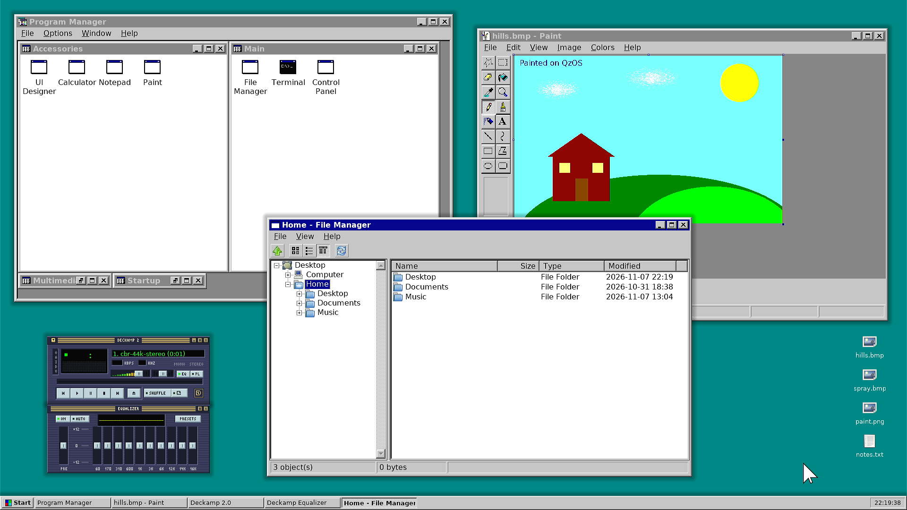
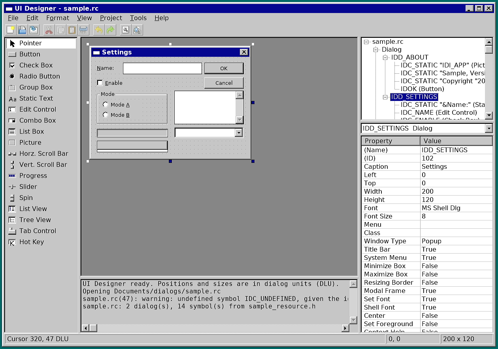
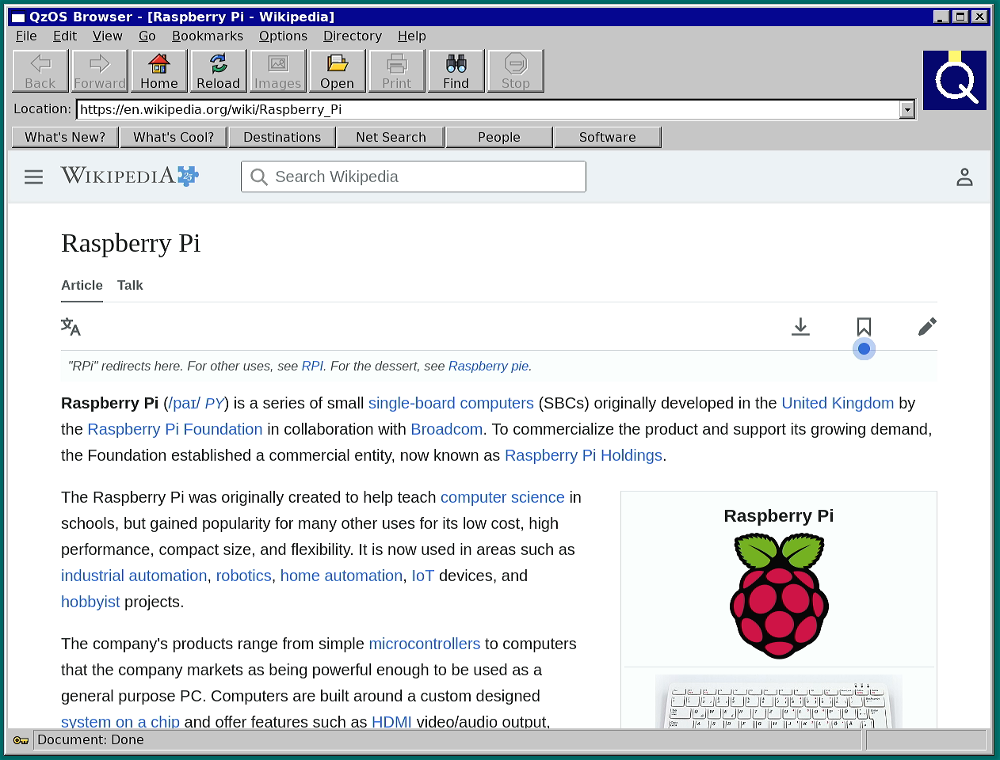
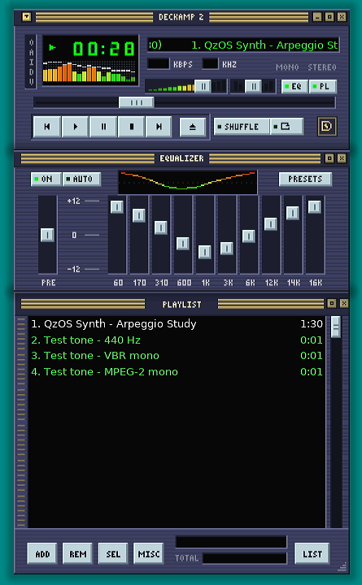
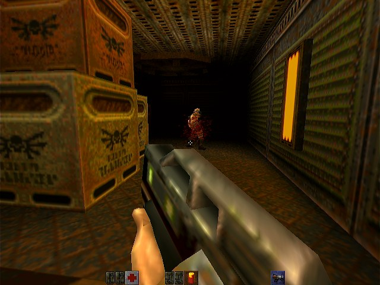
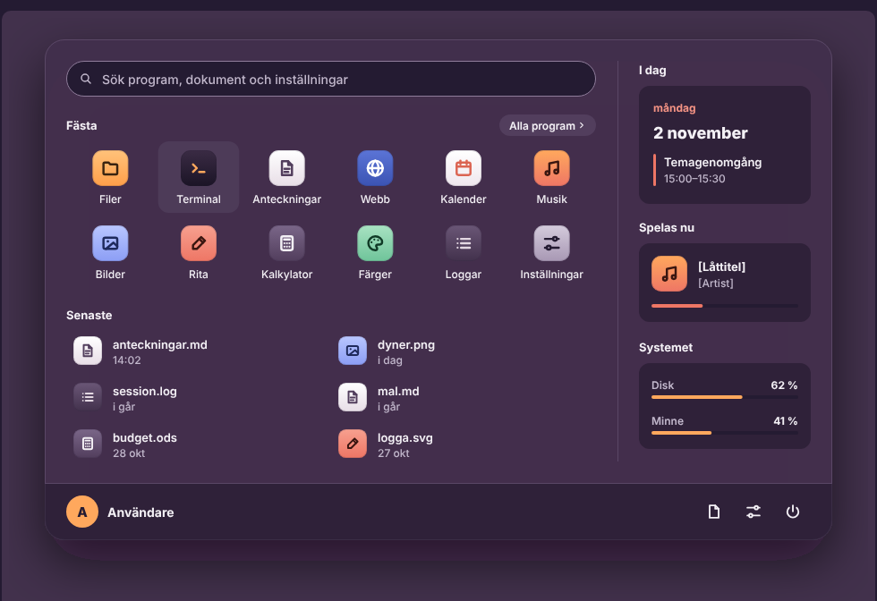

# QzOS

**QzOS is an independent operating system under construction: a native AArch64 kernel, a graphics stack written from the GPU command list up, and a desktop whose programming model is drawn from classic Windows NT, on a Unix-like foundation.**

It is not a Linux distribution, a Windows clone, or a kernel experiment on its own. The aim is a complete system with its own kernel, system services, graphics and display drivers, desktop environment and applications. Both the native kernel and the Linux-hosted graphical environment already run on real Raspberry Pi hardware, and development continues toward one integrated native system.

<p align="center">
  <a href="assets/screenshots/desktop-rpi4-hdmi-full.png"></a>
  <br>
  <sub>The graphical userland on a Raspberry Pi 400, captured from its HDMI output: Program Manager, Paint, Deckamp and File Manager as separate processes on the QzOS window server, hosted on the Linux kernel for now (see below). Select the image for the full 1920×1080 frame.</sub>
</p>

## Building from both ends

Most operating systems grow from the bottom: first the kernel, then drivers, then, much later, a desktop. QzOS is built from both ends at once.

**Bottom-up**, the TOS kernel grows from the CPU, the MMU, the scheduler and the hardware interfaces towards a complete native system.

**Top-down**, the window system, the 2D and 3D graphics, the shell and real applications grow from the application layer towards the kernel interfaces they will need.

The two halves meet at a deliberately narrow boundary. Applications talk to their own libraries; the window server sees images, damage and fences, never drawing calls; the GPU code submits command lists it builds itself. Today the Linux kernel sits underneath the graphical half, providing DRM/KMS, the V3D render node and input devices. It is a temporary host that lets userland and GPU work proceed without waiting for every native driver. The intended platform is TOS.

## The system

**TOS** is the kernel: monolithic, written from scratch for AArch64, with explicit subsystem boundaries and an emphasis on deterministic behaviour and correctness on real hardware. It boots on a Raspberry Pi 4 and on QEMU, brings up all four Cortex-A72 cores, and has preemptive per-CPU scheduling, per-process page tables with copy-on-write `fork`, about 110 system calls, signals and job control, its own file system (qzfs), and its own IPv4/TCP stack over a native Gigabit Ethernet driver. It does not yet have graphics or display drivers, so it does not run the desktop shown here.

**The userland** takes its architecture from classic Windows NT: GDI and USER, message-driven windows, standard controls, dialog resources, MDI, and COM-style object interfaces for the shell. The system beneath remains Unix-like, with UTF-8 text, POSIX files and Unix naming. The goal is not Win32 binary compatibility but a native application environment that keeps what worked in workstation-era desktop design.

**The graphics stack** is QzOS's own. It includes a client-side 2D engine with TrueType text and an SVG icon renderer; a window server and compositor that share GPU buffers with clients through images and fences; QzGL, a fixed-function OpenGL 1.1; and a renderer that drives the Raspberry Pi's V3D GPU with hand-built command lists, without Mesa, beside a software reference renderer. On the Pi the Linux DRM/KMS and V3D drivers are used for now. Native TOS display and GPU drivers are the long-term replacement.

```text
 Applications    Paint, Program Manager, Deckamp, Browser, GL programs, ...
                          |                     |                  |
 Libraries       QzUI (USER/GDI)          QzGL (OpenGL 1.1)     libshell
                          +----------+----------+                  |
 Window server        winsrv: images + fences in, composited out   |
                                     |                             |
 Graphics             V3D command lists, software reference        |
 ------------------------------------+-----------------------------+-----
 Kernel          Linux host today (DRM/KMS, V3D)   ->   TOS, the target
```

## QzOS in action

Every screenshot in this section was captured in November 2026 from a Raspberry Pi 400 (the same BCM2711 SoC as the Pi 4). The machine ran the Linux-hosted graphical stack, and the HDMI output was captured through a USB capture card. The windows were arranged with a scripted virtual mouse and keyboard, through the window server's normal input path.

<table>
  <tr>
    <td width="50%" valign="top">
      
      <br><sub><b>UI Designer</b>, a native dialog and resource editor, editing a <code>.rc</code> dialog resource.</sub>
    </td>
    <td width="50%" valign="top">
      
      <br><sub><b>Browser</b>: a libui window around WPE WebKit. Each page frame reaches the compositor as a GPU buffer with its fence, without a copy.</sub>
    </td>
  </tr>
  <tr>
    <td width="50%" valign="top" align="center">
      
      <br><sub><b>Deckamp</b>, a classic three-window audio player with an original SVG skin, playing a synthesized test tune.</sub>
    </td>
    <td width="50%" valign="top">
      
      <br><sub><b>QzGL</b> running the Quake II (GPL) timedemo at 640×480: rendered on the V3D GPU and presented through KMS.</sub>
    </td>
  </tr>
</table>

## The repositories

QzOS is spread over cooperating repositories. Most are private while the work settles; [QzOS/design](https://github.com/QzOS/design) is public.

| Component | Repository | Role |
|---|---|---|
| TOS | `TOS` | Native kernel and operating system foundation |
| QzUI | `generic_gdi` | 2D engine, `libui`/`libgdi` window API, controls, dialogs, MDI, shell |
| Graphics | `gfx_v3d` | V3D command lists without Mesa, window server and compositor, KMS display |
| QzGL | `opengl` | Fixed-function OpenGL 1.1, software and V3D renderers |
| libshell | `libshell` | COM-style object model and Shell Namespace |
| Design | [`design`](https://github.com/QzOS/design) | Visual direction, themes, icons and component references |
| UI Designer | `uidesigner` | Native dialog and resource editor |

The applications are not demos. Each one is a workload chosen to push the system and expose what is missing:

| Repository | What it exercises |
|---|---|
| `progman` | Program Manager: MDI, window management, dialogs |
| `paint` | Paint: 2D drawing, tools, palettes, user interaction |
| `Deckamp` | An audio player: custom-drawn windows, docking, audio output |
| `browser` | A web browser: compositor, GPU buffers, synchronisation, presentation |
| `opengl_demos` | GLTron and Quake II: real OpenGL workloads on QzGL and the GPU |

`progmanNT`, `paint95` and `uidesignerNT` are Win32 reference implementations. They are used to compare behaviour against the native programs, which are separate code written for QzUI.

## Where it is heading

The destination is a self-contained system: TOS underneath, native display and GPU drivers in place of Linux DRM/KMS, the window server and QzGL on top, and the desktop and its applications running as native TOS processes. Until then, Linux hosts the graphical half, and the boundary between the two halves is kept narrow so that the move stays possible.

The desktop's look is changing as well. The classic NT-style presentation shown above is the stable base. [QzOS/design](https://html-preview.github.io/?url=https://github.com/QzOS/design/blob/main/lekplats/index.html) defines the next one: two themes, Glöd (dark) and Gryning (light), with shared colour roles and component measures, being brought into the toolkit one profile at a time.

<p align="center">
  
  <br>
  <sub>A design reference from QzOS/design: the start panel in the Glöd theme. It is a mockup, not running code.</sub>
</p>

<details>
<summary>TOS booting on a Raspberry Pi 4 (serial log excerpt)</summary>

```text
arch: SCTLR_EL1=0x0000000000C0183D (M=1 C=1 I=1)
[init-stage 2/7] vm/mmu invariants: PASS
init: detected 4 CPU(s)
smp: spin-table wake, entry_pa=0000000000080080, cpus=4
smp3_smoketest: PASSED -- 3/3 AP(s) observed AP-context reschedule IPI receive
sched_preempt_smoketest: PASSED -- timer preemption verified on cortex-a53 and cortex-a72
ramdisk: 2048 KiB image (qzfs) at major=4 minor=0
genet: link up, 1000 Mbps full-duplex (UMAC_CMD=0x00000008, EXT_OOB=0x00F00050)
init: fs_init: vfs core: PASS
```

<sub>Selected lines from a serial-console capture of a full boot on a Raspberry Pi 4 Model B, July 2026. Firmware output and most self-tests are left out.</sub>
</details>

---

<sub>QzOS is developed by Anders Hell. The public entry point today is [QzOS/design](https://github.com/QzOS/design); the screenshots and the kernel log on this page come from the private repositories and their test runs.</sub>
